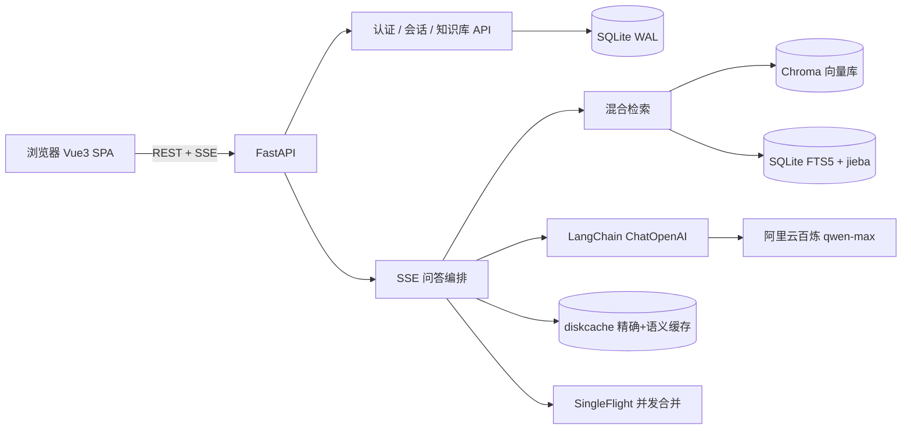
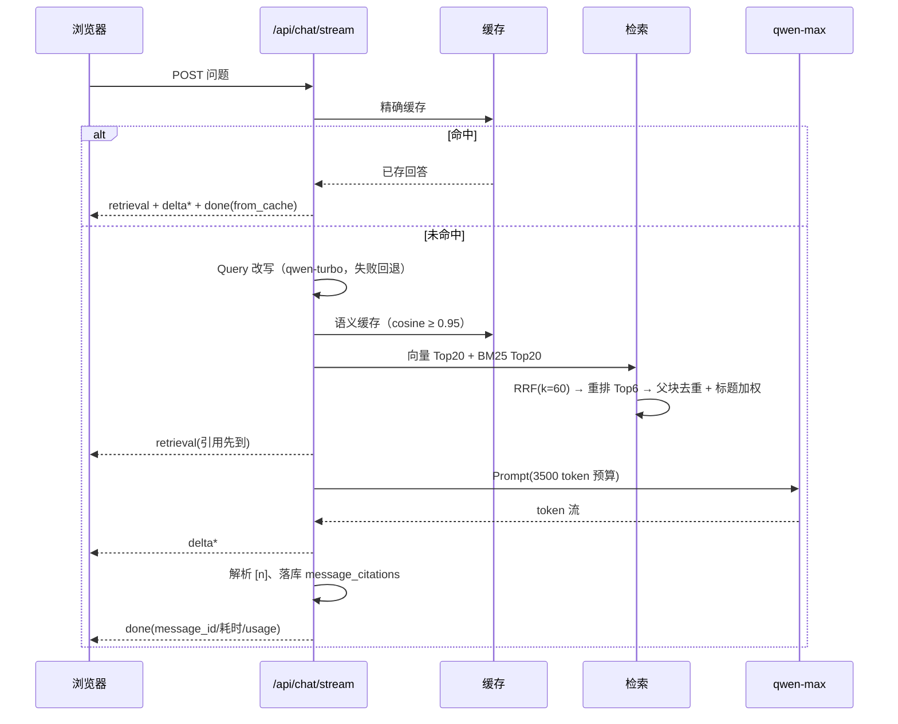
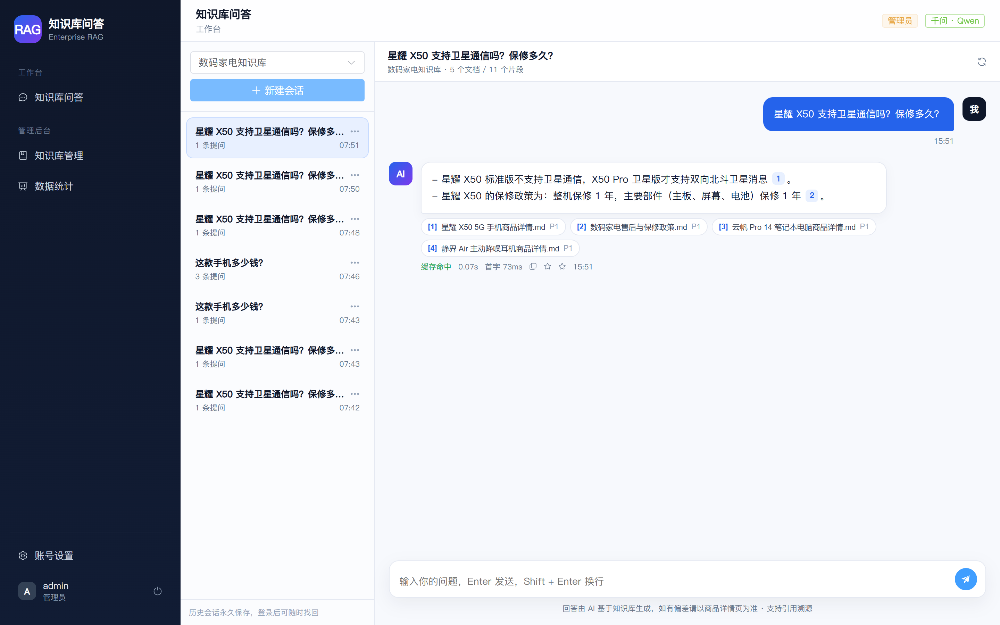
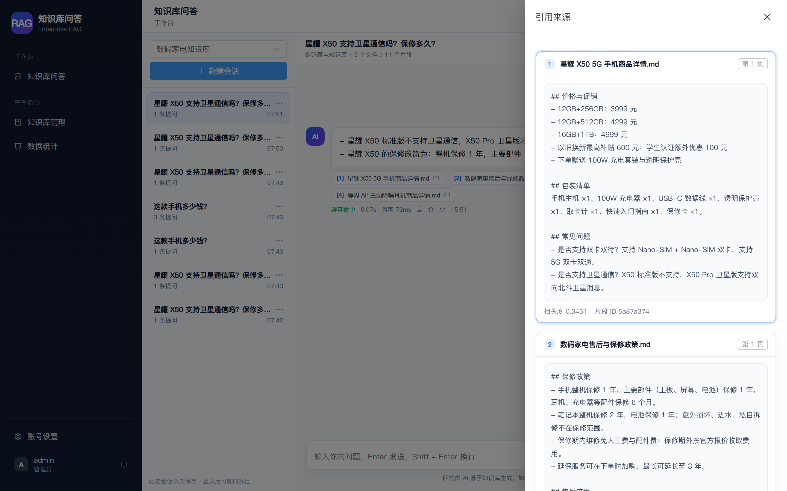
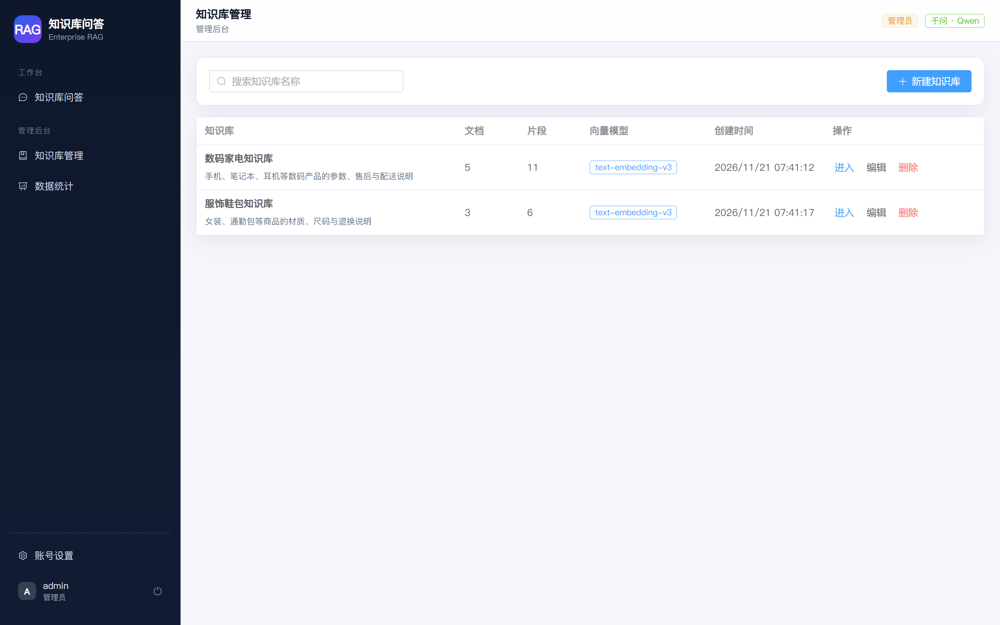
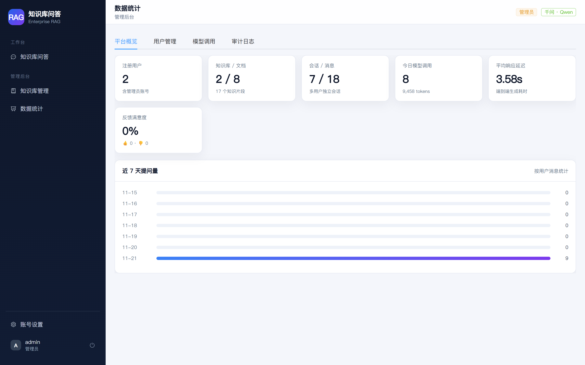

# 电商商品知识库 RAG 问答系统

> 基于 **LangChain + 阿里云百炼（qwen-max）** 的企业级 RAG 知识库问答系统：管理员在浏览器维护商品资料，用户以流式方式获得**带可追溯引用**的回答，多用户会话历史持久化。

[](https://github.com/baibai1323/LangChain-rag/actions/workflows/ci.yml)
[](LICENSE)
[](backend/requirements.txt)
[](backend/tests)
[](https://python.langchain.com/)

## 这个项目解决什么问题

电商客服场景里，商品参数、售后政策、尺码建议散落在详情页和文档里，通用大模型答不准、也不敢答。本系统把商品资料建成知识库，回答**只依据检索到的片段**，并在正文里标出 `[1]`、`[2]` 角标，点击即可查看原文、页码与相关度——既能答，又能查证。

**工程上的三个重点**：混合检索（向量 + BM25 + RRF + 重排）保证召回质量；SSE 流式 + 两级缓存 + 并发合并把首字延迟压到毫秒级；测试、门禁、CI、容器化让项目具备可交付形态。

## 功能

- **知识库管理**（仅管理员）：创建 / 编辑 / 删除知识库；上传 PDF、DOCX、TXT、Markdown、CSV、JSON；后台异步解析、父子切片、向量化、建 FTS5 索引；实时展示入库进度，支持切片预览、重新入库、检索测试。
- **知识库问答**（登录用户）：SSE 先推引用、再逐字生成；`[n]` 角标与“参考来源”均可点开原文抽屉；支持停止生成、复制回答、点赞点踩。
- **多用户多会话**：会话独立、互不可见；新建 / 重命名 / 置顶 / 删除；消息与引用落库，换时间登录可恢复。
- **账号体系**：注册、登录、刷新令牌、修改密码；Argon2id 哈希、JWT 双令牌、登录限流、审计日志。
- **权限控制**：内置管理员 `admin / 123456`；只有管理员能进知识库管理与数据统计，普通用户只能问答。
- **管理与可观测**：平台概览、近 7 天提问趋势、用户禁用、模型调用记录、审计日志、缓存状态；`X-Request-ID` 全链路追踪、`/api/admin/metrics` 运行时 p50/p95 与错误率。

## 架构



### 一次问答的链路



## 技术栈

| 层 | 选型 | 说明 |
| --- | --- | --- |
| Web | FastAPI + Uvicorn | 异步 IO、SSE、OpenAPI |
| LLM 编排 | **LangChain 1.x** | `ChatOpenAI` + LCEL + 自定义 Retriever + 流式回调 |
| 模型 | qwen-max / qwen-turbo | OpenAI 兼容接口，回答 / 改写与标题 |
| Embedding | text-embedding-v3 | 1024 维，批量 + 并发 + 退避 |
| 重排 | gte-rerank-v2 | 原生 Rerank API |
| 关系存储 | SQLite（WAL）+ SQLAlchemy 2 Async | 用户、会话、消息、文档元数据 |
| 关键词检索 | SQLite FTS5 + jieba | 预分词 BM25，中文商品词召回 |
| 向量库 | Chroma（本地持久化） | cosine，`asyncio.to_thread` 包装 |
| 缓存 | diskcache | 精确缓存 + 语义缓存 + 变更失效 |
| 前端 | Vue 3 + TS + Vite + Pinia + Element Plus | 路由懒加载、vendor 分包 |
| 认证 | Argon2id + PyJWT | Access 30min / Refresh 7d |
| 交付 | GitHub Actions + Docker + pytest | CI、单测、pre-commit 质量门禁 |

### 为什么这么选

- **SQLite + Chroma 而不是 PostgreSQL/pgvector**：单机部署、零外部服务，WAL 下读写足够；Chroma 与 FTS5 各司其职，检索层保持可替换。
- **RRF 而不是加权分数融合**：向量与 BM25 分数量纲不同，RRF 只用排名，免调权重。
- **先引用后生成**：SSE 第一个业务事件就带 `retrieval`，用户不必等答案出来才看到依据。
- **缓存分级**：精确缓存挡重复问题；语义缓存挡“同义问法”；知识库变更时按 `kb_id` 整体失效，避免脏答案。

## 性能数据

环境：本机 Windows、SQLite/Chroma 本地、DashScope 云端模型；数据来自 [`scripts/bench.py`](scripts/bench.py)，原始记录在 [`docs/benchmark.json`](docs/benchmark.json) 与 [`docs/benchmark-cold.json`](docs/benchmark-cold.json)。

| 场景 | 首字延迟 | 整轮耗时 | 说明 |
| --- | --- | --- | --- |
| 热缓存（6 轮） | p50 **15ms** / p95 25ms | p50 **63ms** / p95 110ms | 精确缓存命中，直接回放 |
| 冷链路（3 轮） | p50 2.4s / p95 3.3s | p50 3.5s / p95 4.7s | 含改写、检索、重排、生成 |
| 并发 5 个相同问题（热） | — | 墙钟 **184ms** | 语义缓存 + 并发合并 |
| 并发 3 个相同问题（冷） | — | 墙钟 **3.3s** | SingleFlight 只跑一次检索 |

> 冷链路受百炼免费额度 RPM 限制（429），改写失败会立即回退原问题，不再重试 13s；这是压测中发现并修掉的真实问题。

## 快速开始

### 方式一：Docker

```bash
export DASHSCOPE_API_KEY=sk-你的百炼Key
docker compose up --build
# http://127.0.0.1:8000
```

### 方式二：本地

```powershell
python -m venv .venv
.\.venv\Scripts\python.exe -m pip install -r backend\requirements.txt

cd frontend
npm install
npm run build
cd ..

# 项目根目录创建 .env（不要提交）
# DASHSCOPE_API_KEY=sk-你的百炼Key

.\start.bat
```

浏览器打开 <http://127.0.0.1:8000>。演示数据（可选）：

```powershell
.\.venv\Scripts\python.exe scripts\seed_demo.py
```

内置账号：

| 账号 | 密码 | 角色 | 权限 |
| --- | --- | --- | --- |
| admin | 123456 | 管理员 | 问答 + 知识库管理 + 数据统计 |
| demo | demo123 | 普通用户 | 仅问答 |

## 目录结构

```
backend/app
├── api/            # auth / kbs / documents / conversations / chat / admin
├── rag/            # extract / splitter / tokens / vectorstore / retriever / prompt
├── services/       # ingest / chat / cache / ratelimit / singleflight
├── observability.py# 请求追踪中间件 + 运行时指标
├── llm.py          # Chat / Embedding / Rerank 封装与重试预算
├── security.py     # Argon2 + JWT
└── main.py         # 应用入口、静态托管、SPA fallback

backend/tests       # 121 条 pytest 用例
frontend/src        # api / components / layouts / views / stores / router
scripts             # bench / smoke_test / seed_demo / check_api
tools/quality-gate  # pre-commit 质量门禁
agents              # tester / quality-engineer / gitcommit-agent
.dsh/skills         # 项目内技能（测试、安全、注释、提交）
```

## 关键设计

### 检索质量

1. **Query 改写**：带最近 8 条历史，把追问改写成独立问题；失败 60s 冷却并回退原问题，绝不拖慢首字。
2. **混合召回**：向量 Top20 + BM25 Top20，中文用 jieba 预分词写入 FTS5。
3. **RRF 融合**：`score = Σ 1/(k + rank)`，`k=60`。
4. **重排与去重**：gte-rerank-v2 取 Top6；同一父块只保留最高分；文档名命中查询词加 ≤0.08，让“这款手机”优先落到对应商品。
5. **上下文预算**：3500 token 装父块，编号与引用表一致。

### 引用一致性

- 检索结果编号 `[1..n]` 同时进入 Prompt 与 `message_citations`。
- 生成后只保留真实存在的编号；模型沿用历史编号会被 Prompt 禁止，前端也只渲染合法 rank。
- 模型没标引用时仍展示“参考来源”，保证可追溯。

### 性能与稳定性

- **SSE 手写协议**：`status → retrieval → delta* → done`，先给依据再给答案。
- **两级缓存**：精确（问题规范化哈希）+ 语义（cosine ≥ 0.95），知识库变更按 `kb_id` 失效。
- **SingleFlight**：同一知识库的相同问题并发时，Embedding 与检索只执行一次，其余请求共享结果。
- **重试预算**：所有模型调用带 deadline，退避放不进预算就立即失败降级，避免 429 叠加成十几秒。
- **可观测**：`X-Request-ID` 透传、`X-Response-Time-Ms` 回写、`/api/admin/metrics` 输出 p50/p95 与错误率。

### 数据一致性

- 先写 `chunks` 再写 Chroma；Chroma 失败回滚切片，文档标记失败并可重新入库。
- 删除文档 / 知识库时同步清理向量与缓存。

## 质量保障

| 项 | 结果 |
| --- | --- |
| 单元测试 | **121 passed**，约 25s，整体覆盖率 66%；tokens/prompt/schemas/security/ratelimit 等关键模块 100% |
| 接口冒烟 | `scripts/smoke_test.py` 12/12（健康检查、注册登录、鉴权、KB CRUD、管理员权限） |
| 变异测试 | 把型号正则改回旧版，2 条用例立即变红，恢复后全绿 |
| CI | GitHub Actions：后端 pytest + 前端 `tsc --noEmit` + `vite build` |
| 提交门禁 | pre-commit 校验 tester / quality-engineer 凭证并亲自跑 pytest，凭证随代码变更失效 |

```powershell
.\.venv\Scripts\python.exe -m pytest backend\tests
.\.venv\Scripts\python.exe -m pytest --cov=backend/app --cov-report=term-missing
```

技能与子代理：`.dsh/skills/`（unit-test-rag、security-audit、check-comments、git-save）、`agents/`（tester、quality-engineer、gitcommit-agent）、`tools/quality-gate/`。

## 接口

启动后访问 `/api/docs` 查看 Swagger。

| 方法 | 路径 | 说明 |
| --- | --- | --- |
| POST | /api/auth/register · login · refresh · password | 注册 / 登录 / 刷新 / 改密 |
| GET/POST | /api/kbs | 列表 / 创建（管理员） |
| POST | /api/kbs/{id}/documents | 上传（202 + task_id） |
| GET | /api/tasks/{id} | 入库进度 |
| POST | /api/kbs/{id}/search-test | 检索测试（管理员） |
| GET | /api/conversations · /{id}/messages | 会话与历史 |
| POST | /api/chat/stream | SSE 问答 |
| POST | /api/messages/{id}/feedback | 点赞 / 点踩 |
| GET | /api/admin/stats · metrics · users · audit-logs | 统计与可观测（管理员） |

SSE 事件：`status` → `retrieval` → `delta`* → `done`，异常时 `error`。

## 界面

| 问答与引用 | 引用抽屉 |
| --- | --- |
|  |  |

| 知识库管理 | 数据统计 |
| --- | --- |
|  |  |

更多见 [`docs/screenshots`](docs/screenshots)。

## 简历可用的表述

> **电商知识库 RAG 问答系统**（个人项目｜LangChain / FastAPI / Vue3）
>
> - 设计“向量 + BM25 双路召回 → RRF 融合 → gte-rerank 重排 → 父块去重”的检索链路，解决商品型号类 query 的召回与排序问题；
> - 实现 SSE 流式问答与引用溯源：先推引用再逐字生成，回答中的角标可定位原文；用精确 + 语义两级缓存与 SingleFlight 并发合并，热缓存首字 p50 15ms、整轮 63ms；
> - 通过真实压测定位云端 429 重试叠加导致的首字 13.7s 问题，引入总预算退避与改写冷却，冷链路首字降到 2.4s；
> - 落地 121 条 pytest 用例、GitHub Actions CI、Docker Compose 与 pre-commit 质量门禁，保证可回归、可部署。

## 常见问题

**没有 `.env` 能启动吗？** 能启动，但问答与入库会因缺少密钥失败。

**上传后一直“处理中”？** 看后端日志与文档状态，常见是 Embedding 限流或解析失败；可“重新入库”。

**回答没有引用？** 确认知识库有“已就绪”文档，用管理员“检索测试”验证召回；阈值 0.05 会过滤低相关片段。

**换电脑历史还在吗？** 在，会话与消息在 SQLite；同一账号登录即可恢复。

## 安全说明

- Argon2id 密码哈希；JWT 双令牌，改密后 `token_version` 提升使旧令牌失效。
- 登录 / 注册按 IP 限流（10 次/分钟），问答按用户限流（30 次/分钟）。
- 管理接口 `require_admin`；会话与消息校验归属；上传限制 20MB 与扩展名白名单。
- 密钥只从 `.env` / 环境变量读取，`.gitignore` 排除 `.env`、`data/`。

## License

[MIT](LICENSE) © 2026 baibai1323
